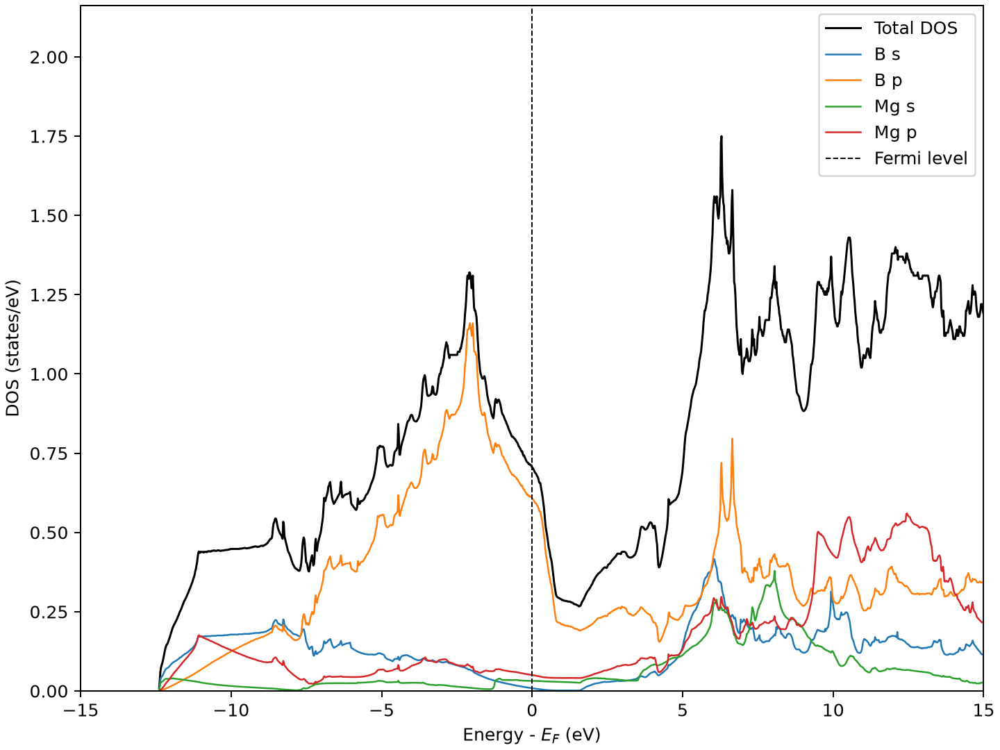

# MgB₂のSCF・バンド構造・PDOS計算

- 実施日: 2026-11-21
- 状態: 全計算段階が正常終了。物理的妥当性は未検証。
- 対象物質: MgB₂
- 実行環境: `ubuntu2404`（`mdx-server`）、OpenMP 4スレッド、PBS・MPIなし
- QE: `/home/mdx-user01/program/q-e-7.6/bin/`（QE 7.6）

## 目的

複数元素を含むMgB₂に対し、一般化したスクリプトでSCF → バンド構造 → NSCF/PDOSの一連の処理を実行し、Mg・Bの両方の投影状態密度を得る。

## 入力と実行

- 入力ZIP: `/home/mdx-user01/Downloads/PWscf.zip`
- 作業ディレクトリ: `/home/mdx-user01/work/MgB2-scf-2026-11-21-run1/PWscf/`
- 入力ZIPのSHA-256、擬ポテンシャル、`ecutwfc` / `ecutrho`、SCF k点メッシュ、smearing、フェルミ準位: **未記録**。計算サーバー上の `run-metadata.txt` と `pwscf.in` から追記する。

```bash
MATERIAL_LABEL=MgB2 RUN_NAME=MgB2-scf-2026-11-21-run1 \
  bash scripts/qe_mdx_scf_openmp.sh ~/Downloads/PWscf.zip

source ~/.venvs/qe-tools-v1/bin/activate
bash scripts/qe_mdx_band_openmp.sh ~/work/MgB2-scf-2026-11-21-run1
bash scripts/qe_mdx_pdos_openmp.sh ~/work/MgB2-scf-2026-11-21-run1
```

バンド図には、SeeK-pathによる不連続なk点経路を線で結ぶ表示上の問題が見つかった。`plot_bands.py` を修正し、QEのバンド計算を再実行せずに再描画した。

### 一コマンドCLIの再実行

入力を `~/qe-inputs/MgB2/PWscf.zip` に配置し、直接実行用の一コマンドCLIを再実行した。

```bash
cd ~/qe-automation
make run MATERIAL=MgB2
```

2026-11-21に `Workflow completed successfully.` が出力され、SCF → バンド → NSCF/PDOSの順次実行が完了した。このCLIは各段階で既存スクリプトの成功確認を行い、失敗時には後続段階へ進まない。今回の固有実行ディレクトリ名と入力ZIPのSHA-256は未記録であり、必要ならサーバー側の実行出力と `run-metadata.txt` から追記する。

### Web API・待ち行列ワーカーの統合検証

FastAPIのローカルAPI（`127.0.0.1:8000`）へ同じMgB₂入力ZIPを送信し、SQLite待ち行列から別プロセスのワーカーが直接実行する構成を確認した。

- 匿名ブラウザCookieを付けたアップロードでジョブが `QUEUED` になった。
- ワーカーが `SCF_RUNNING` へ遷移させ、SCFを正常完了した。
- 初回はWeb API用仮想環境にSeeK-path依存がなく、`BAND_RUNNING` で停止した。これは物理計算の失敗ではなく、ワーカーのPython環境設定の問題だった。
- ワーカーが `~/.venvs/qe-tools-v1` を子プロセス用に使うよう修正後、同じ入力を新規ジョブとして再投入し、`COMPLETED` まで到達した。

この検証はまだmdx-server内部だけで行っており、学校Wi-Fiからのアクセス、ブラウザ画面、キャンセル、タイムアウト、再起動時の回復は未検証である。

### ブラウザUIのE2E検証

2026-11-22に、SSHトンネル経由でReact/Viteの最小フロントエンドを開き、MgB₂の`PWscf.zip`をブラウザから登録した。

- 物質名ラベルとZIP選択、待ち行列への追加をブラウザ上で確認した。
- ジョブ詳細は`SCF計算中`から`完了`へ更新された。
- `worker.log` をブラウザで確認できた。
- 完了後、バンド図とPDOS図が同じ画面に表示された。

この結果により、ローカル限定の開発環境において、ブラウザからの入力登録 → 待ち行列 → 直接実行ワーカー → 結果閲覧のE2Eフローが成立した。サーバー上の絶対パスをログ画面へ表示しない処理、キャンセル、タイムアウト、再起動回復、学校Wi-Fiからの公開は未検証である。

## 実行結果

以下すべてに `JOB DONE.` を確認した。

- `scf.out`
- `band.out`
- `nscf.out`
- `pdos.out`

主な生成物は `bands.out.gnu`、`bands-fixed.png`、`aiida.pdos_tot`、`pdos_Mg_*.dat`、`pdos_B_*.dat`、`pdos.png` である。




## 結果の読み取り

- バンド図では複数のバンドがフェルミ準位（`0 eV`）を横切る。
- 全DOSもフェルミ準位近傍でゼロではない。
- この計算条件では、MgB₂はバンドギャップを持つ半導体ではなく、金属的な電子状態を示す。
- フェルミ準位近傍にはB p成分が見え、Mg由来の成分も混ざる。これは投影状態密度に基づく定性的な観察であり、軌道ごとの電子数を直接示すものではない。

## 妥当性の確認

今回確認できたのは、入力ZIP・QE実行環境・複数元素PDOSの自動処理が成立したことと、バンド図・DOS図の定性的観察が整合することである。

未確認の事項は以下である。

- 構造、擬ポテンシャル、カットオフ、SCF/NSCF k点メッシュの収束性
- `nbnd` が目的とする非占有状態とPDOSのエネルギー範囲に十分か
- 計算条件をそろえた文献値・基準計算との比較

収束試験の条件と合格基準は、研究結論に影響するため、指導教員と相談してから採用する。

## 次の実験（提案）

1. 現在の `pwscf.in` と `run-metadata.txt` から未記録の入力条件を追記する。
2. カットオフとSCF k点メッシュについて、一度に一つだけ変えた収束試験を実施する。
3. 採用候補の条件で、バンド・PDOSを再計算し、今回の図との変化を比較する。
