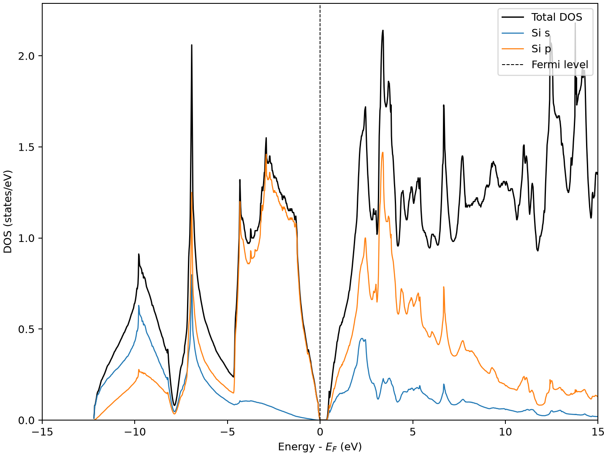

# シリコン基準入力のNSCF・PDOS計算

- 実施日: 2026-11-19
- 状態: NSCF・PDOS計算とPDOS図の生成が正常終了。物理的妥当性は未検証。
- 対象物質: Si
- 前段: [SCF計算](2026-11-19-scf.md)、[バンド構造計算](2026-11-19-band.md)

## 目的

SCF結果を用いてNSCF計算と原子・軌道投影DOS計算を行い、全DOSとSiのs/p軌道成分をフェルミ準位基準で可視化する。

## 実行環境・入力

- ホスト: `ubuntu2404`（`mdx-server`）
- QE: `pw.x`、`projwfc.x`、`sumpdos.x`（`~/program/q-e-7.6/bin/`）
- 実行方式: OpenMP 4スレッド、PBS・MPIなし
- Python描画環境: `~/.venvs/qe-tools-v1/` のMatplotlib 3.11.2
- `nscf.in`: `pwscf.in` を複製し、`calculation = 'nscf'`、`nbnd = 16`、`occupations = 'tetrahedra_opt'` に変更
- `pdos.in`: `outdir = './out/'`、`prefix = 'aiida'`、`deltae = 0.02 eV`
- フェルミ準位: 6.4775 eV（SCF出力から取得）

## 実行結果

- `nscf.out`: `JOB DONE.` をスクリプトで確認
- `pdos.out`: `JOB DONE.` をスクリプトで確認
- Si s軌道: `aiida.pdos_atm#1(Si)_wfc#1(s)` と `aiida.pdos_atm#2(Si)_wfc#1(s)` を `sumpdos.x` で集計
- Si p軌道: `aiida.pdos_atm#1(Si)_wfc#2(p)` と `aiida.pdos_atm#2(Si)_wfc#2(p)` を `sumpdos.x` で集計
- 主な生成物: `nscf.in`、`nscf.out`、`pdos.in`、`pdos.out`、`aiida.pdos_tot`、`pdos_Si_s.dat`、`pdos_Si_p.dat`、`pdos.png`
- 結果図: [`output/pdos.png`](output/pdos.png)

## 結果の読み取り

- フェルミ準位（0 eV）近傍で全DOSがほぼ0となっており、バンド図で見えたギャップらしき領域と整合する。
- 価電子帯上端に近い領域ではSi p成分がs成分より大きく、p成分が主に寄与しているように見える。
- より深い価電子帯にもs成分とp成分の両方があり、Siの結合状態を単一軌道だけで表せないことが分かる。
- 伝導帯側でもp成分が大きい領域がある。

これらは図からの定性的観察である。投影DOSは選んだ原子軌道への投影であり、全DOSとの差を単純に「欠落した軌道」と解釈しない。バンドギャップ値、軌道寄与の定量値、収束性は未検証である。

## 実装上の記録

最初のPDOS実行では、計算・軌道集計の後、描画スクリプトを相対パスで参照したため描画段階だけで停止した。`nscf.out`、`pdos.out`、軌道別データは生成済みだったため、Matplotlib描画を手動実行して `pdos.png` を得た。その後、`qe_mdx_pdos_openmp.sh` は実行開始時にスクリプトの絶対パスを取得するよう修正した。

### Web UIのE2E検証（2026-11-22）

基準入力`docs/experiments/silicon/input/PWscf.zip`をWeb UIから`Si`として登録し、API・SQLite待ち行列・直接実行ワーカーを経由して実行した。

- ZIP検証は成功した（2エントリ、展開後1,592,430 bytes）。
- SCF、Band、NSCF、PDOSの各段階が成功した。
- SeeK-pathはSiを面心立方（`cF`）として認識し、`Γ → X → U → K → Γ → L → W → X`の経路を生成した。
- ブラウザ上で進捗・ログ・バンド図・PDOS図を確認した。

これにより、MVP完成条件にあるSiの通常系E2Eフローは満たした。入力不備の失敗表示は別途確認済みだが、キャンセル、タイムアウト、API/ワーカー再起動からの回復は未検証である。

## 妥当性の確認

- QEの正常終了と、シリコンの物理的に正しいDOSが得られたことは区別する。
- カットオフ、k点メッシュ、`nbnd`、smearing／tetrahedra設定の収束性は未検証。
- 実験値・文献値とのバンドギャップ比較は未実施。

## 次の実験・作業

1. SCF → バンド構造 → PDOSのCLIフローで必要だった入力・出力・状態遷移を整理する。
2. このフローをGUIバックエンドが実行・監視する処理単位へ分割する。
3. 必要に応じて、収束試験や実験値との比較を別実験として実施する。
